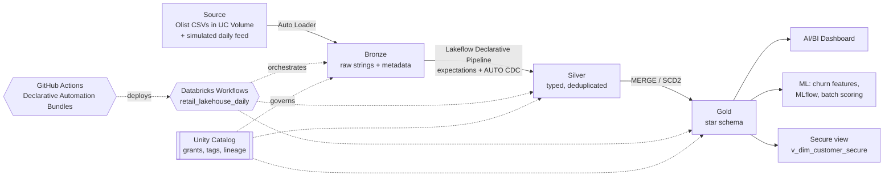

# Databricks Retail Orders Lakehouse: An End-to-End Batch and Streaming Pipeline

[](https://github.com/MichaelY-Dem/databricks-retail-lakehouse/actions/workflows/ci.yml)


A production-style medallion lakehouse on Databricks that ingests the Olist Brazilian e-commerce dataset plus a simulated daily order feed, cleans it with a Lakeflow Declarative Pipeline, and models it into a Gold star schema with SCD Type 2 history. The pipeline is orchestrated as a scheduled Databricks Workflow with a failing quality gate, governed by Unity Catalog (PII tags, masked secure view, least-privilege grants), deployed by GitHub Actions with Declarative Automation Bundles (formerly Databricks Asset Bundles), and consumed by an AI/BI dashboard and an MLflow churn model.

---

## Table of Contents

- [Highlights](#highlights)
- [Architecture](#architecture)
- [Tech Stack](#tech-stack)
- [Dataset](#dataset)
- [Phase 1: Setup](#phase-1-setup)
- [Phase 2: Bronze (Auto Loader)](#phase-2-bronze-auto-loader)
- [Phase 3: Silver (Lakeflow Declarative Pipeline)](#phase-3-silver-lakeflow-declarative-pipeline)
- [Phase 4: Gold (Star Schema + SCD Type 2)](#phase-4-gold-star-schema--scd-type-2)
- [Phase 5: Performance Tuning](#phase-5-performance-tuning)
- [Phase 6: Governance (Unity Catalog)](#phase-6-governance-unity-catalog)
- [Phase 7: Orchestration (Databricks Workflows)](#phase-7-orchestration-databricks-workflows)
- [Phase 8: CI/CD](#phase-8-cicd)
- [Phase 9: Dashboard (AI/BI)](#phase-9-dashboard-aibi)
- [Phase 10: Machine Learning (Churn)](#phase-10-machine-learning-churn)
- [Challenges and Fixes](#challenges-and-fixes)
- [Repository Structure](#repository-structure)
- [How to Run It](#how-to-run-it)
- [What I'd Do Next](#what-id-do-next)

---

## Highlights

| Area | Result |
|---|---|
| **Ingestion** | Incremental Auto Loader with checkpoints; a 5-row batch loaded alone (99,441 → 99,446), no duplicates on re-run |
| **Data quality** | Expectations drop bad rows (1 dropped); Silver has 0 null and 0 duplicate order IDs |
| **Late-arriving data** | AUTO CDC sequenced by event time + ingest time, so a stale record can't overwrite a newer one |
| **Modeling** | Star schema, fact grain = order line item (112,650 rows), SCD2 `dim_customer` with point-in-time joins |
| **Performance** | Liquid clustering + OPTIMIZE: data scanned **−84%**, scan time **151 ms → 7 ms (~21x)**, files 400 → 6 |
| **Governance** | PII tags, masked dynamic secure view, least-privilege grants, automatic lineage |
| **Orchestration** | 6-task daily job (~4.5 min) with retries, alerts, and a 10-check quality gate that fails the job |
| **CI/CD** | 19 pytest tests on every push/PR; deploy runs only if tests pass (~1 min total) |
| **BI** | 2-page AI/BI dashboard: Sales Overview ($16M revenue, 98.35K orders) and Pipeline Health |
| **ML** | Churn model in MLflow + UC registry (`@champion`); lift **1.61x** at top 10%, honest about weak signal |

---

## Architecture



Unity Catalog lineage captured automatically from Bronze through Silver to Gold `fact_orders`:


---

## Tech Stack

| Category | Tools |
|---|---|
| Platform | Databricks Free Edition (serverless compute) |
| Languages | Python, PySpark, SQL |
| Storage | Delta Lake, Unity Catalog Volumes |
| Ingestion | Auto Loader (`cloudFiles`), `trigger(availableNow=True)` |
| Transformation | Lakeflow Declarative Pipelines (expectations, AUTO CDC), Delta `MERGE` |
| Performance | Liquid clustering, `OPTIMIZE` |
| Governance | Unity Catalog (comments, tags, grants, dynamic views, lineage, `information_schema`) |
| Orchestration | Databricks Workflows (Jobs) |
| CI/CD | GitHub Actions, pytest, Declarative Automation Bundles (formerly Databricks Asset Bundles) |
| BI | Databricks AI/BI Dashboards |
| ML | scikit-learn, MLflow tracking, Unity Catalog Model Registry |

---

## Dataset

[Olist Brazilian E-Commerce](https://www.kaggle.com/datasets/olistbr/brazilian-ecommerce) (Kaggle), orders from 2016 to 2018.

| Table | Rows | Columns |
|---|---:|---:|
| orders | 99,441 | 8 |
| order_items | 112,650 | 7 |
| customers | 99,441 | 5 |
| products | 32,951 | 9 |
| payments | 103,886 | 5 |

A **simulated daily feed** adds new orders each run and deliberately includes **1 duplicate and 1 invalid row (null `order_id`)** so the quality controls are exercised on every run.

---

## Phase 1: Setup

Notebook: [`notebooks/00_setup.ipynb`](notebooks/00_setup.ipynb)

- Unity Catalog catalog `retail_lakehouse` with schemas `bronze`, `silver`, `gold`, `ml`.
- Raw CSVs stored in a Unity Catalog Volume, one folder per table, so Auto Loader can track each source independently.
- First read validates row counts for every file before any pipeline is built.

<table>
  <tr>
    <td></td>
    <td></td>
  </tr>
  <tr>
    <td align="center"><sub>Volume with 5 source folders</sub></td>
    <td align="center"><sub>First read: row counts per file</sub></td>
  </tr>
</table>

---

## Phase 2: Bronze (Auto Loader)

Notebooks: [`01_bronze_ingestion.ipynb`](notebooks/01_bronze_ingestion.ipynb), [`02_simulate_new_orders.ipynb`](notebooks/02_simulate_new_orders.ipynb)

- Incremental ingestion with **Auto Loader** (`cloudFiles`) and `trigger(availableNow=True)`, so it runs as a batch job but only picks up new files.
- **Checkpoints** guarantee exactly-once file processing: re-running the notebook adds no duplicates.
- Data lands as all-string raw columns plus metadata: `_ingested_at`, `_source_file`, `_rescued_data` (malformed values are captured, not lost).
- Delta **time travel** available for audit and recovery.
- Test: a 5-row batch file was loaded on its own, taking orders from **99,441 → 99,446**.

<table>
  <tr>
    <td></td>
    <td></td>
  </tr>
  <tr>
    <td align="center"><sub>Bronze row counts after the new batch (orders 99,446)</sub></td>
    <td align="center"><sub>Rows loaded per source file (99,441 + 5)</sub></td>
  </tr>
</table>

---

## Phase 3: Silver (Lakeflow Declarative Pipeline)

Pipeline: [`pipelines/silver_pipeline.py`](pipelines/silver_pipeline.py) · Checks: [`03_silver_checks.ipynb`](notebooks/03_silver_checks.ipynb)

- **Views with expectations feed streaming tables**: `expect_or_drop` removes invalid rows (e.g. null `order_id`); `expect` records warnings without dropping.
- `try_cast` / `try_to_timestamp` for safe typing, because serverless runs in **ANSI mode** and a plain cast would crash on bad values.
- **AUTO CDC** (`apply_changes`) deduplicates by business key.
- **Late-arriving data**: `sequence_by` uses event time (greatest of the order timestamps) plus ingest time, so a stale record arriving late cannot overwrite a newer one.
- Results: **1 bad row dropped, 0 nulls, 0 duplicates**, orders = **99,444**.


<sub>Pipeline graph: 5 Bronze sources → 5 validated views → 5 streaming tables</sub>

<table>
  <tr>
    <td></td>
    <td></td>
  </tr>
  <tr>
    <td align="center"><sub><code>orders_clean</code> expectations: <code>valid_order_id</code> dropped 1 record</sub></td>
    <td align="center"><sub>Late-arriving test: order shows "delivered" from the update file</sub></td>
  </tr>
</table>

<details>
<summary>Silver row counts and null/duplicate checks</summary>

<table>
  <tr>
    <td></td>
    <td></td>
  </tr>
  <tr>
    <td align="center"><sub>Silver row counts</sub></td>
    <td align="center"><sub><code>null_order_ids</code> 0, <code>duplicate_order_ids</code> 0</sub></td>
  </tr>
</table>
</details>

---

## Phase 4: Gold (Star Schema + SCD Type 2)

Notebooks: [`04_gold_build.ipynb`](notebooks/04_gold_build.ipynb), [`05_gold_checks.ipynb`](notebooks/05_gold_checks.ipynb)

- **`fact_orders`** at the grain of one row per order line item; money stored as `DECIMAL(10,2)`.
- **`dim_customer`** is SCD Type 2, built with a single hand-written `MERGE` using the **NULL merge-key technique** and a `row_hash` to detect changes. First version is effective from `1900-01-01` so historic orders always match.
- **`dim_product`** is SCD Type 1 (`MERGE`); **`dim_date`** covers 2016–2027.
- **Point-in-time join**: each order links to the customer version where purchase time is between `effective_from` and `effective_to`. The build is idempotent.
- Counts: `dim_customer` 99,441 (99,442 after SCD2 test), `dim_product` 32,951, `dim_date` 4,383, `fact_orders` 112,650.

**SCD2 test:** a customer moved from *Nova Venecia, ES* to *Rio De Janeiro, RJ*. Their February 2017 order still points to the old address.

<table>
  <tr>
    <td></td>
    <td></td>
  </tr>
  <tr>
    <td align="center"><sub>SCD2 history: 2 versions of the customer</sub></td>
    <td align="center"><sub>Point-in-time proof: old order → old city (<code>is_current = false</code>)</sub></td>
  </tr>
</table>

<details>
<summary>Gold row counts and integrity checks</summary>

<table>
  <tr>
    <td></td>
    <td></td>
  </tr>
  <tr>
    <td align="center"><sub>Gold row counts</sub></td>
    <td align="center"><sub>Integrity checks: all 0</sub></td>
  </tr>
</table>
</details>

---

## Phase 5: Performance Tuning

Notebook: [`06_performance_tuning.ipynb`](notebooks/06_performance_tuning.ipynb)

- The real fact table was too small to show measurable gains, so I benchmarked a **30x scaled copy (~3.4M rows)** written as **400 small unsorted files**.
- Compared against **liquid clustering** `CLUSTER BY (purchase_date_key, product_sk)` + `OPTIMIZE`.
- Clustering keys were chosen from the dashboard's filter patterns (date range, product/category).
- Benchmark query: January 2018 revenue. Clustering was then applied to the real Gold tables.

| Metric | Before | After | Change |
|---|---:|---:|---:|
| Files in table | 400 | 6 | |
| Storage | 165.8 MB | 79.6 MB | −52% |
| Files read | 400 | 2 (4 pruned) | |
| Rows scanned | 3,379,500 | 1,100,850 | −67% |
| Data scanned | 165.81 MB | 25.88 MB | −84% |
| Scan time | 151 ms | 7 ms | ~21x faster |
| Peak memory | 226 MB | 32 MB | −86% |
| Median query time | 1.089 s | 0.902 s | |

<table>
  <tr>
    <td></td>
    <td></td>
  </tr>
  <tr>
    <td align="center"><sub><b>Before:</b> 0 files pruned, 400 read</sub></td>
    <td align="center"><sub><b>After:</b> 4 files pruned, 2 read</sub></td>
  </tr>
</table>

---

## Phase 6: Governance (Unity Catalog)

Notebook: [`07_governance.ipynb`](notebooks/07_governance.ipynb) (re-runnable; runs after every Gold build)

- **Table and column comments**, plus tags for `layer`, `domain`, and `PII`; PII columns are tagged individually.
- **Dynamic secure view `v_dim_customer_secure`**: `customer_unique_id` is SHA-2 hashed and zip codes are masked to `"29***"` unless the user is in `pii_readers`. Hashed IDs still support `COUNT DISTINCT`, so analytics keep working.
- **Least-privilege grants** to `account users`: Gold is read-only and customer data is reachable only through the secure view; no access to Bronze, Silver, or raw PII.
- **`information_schema` reports**: a catalog report with comments and a PII inventory from `column_tags`.
- **Automatic lineage** across all layers (see [Architecture](#architecture)).

| Role | Bronze / Silver | Gold tables | `dim_customer` raw | `v_dim_customer_secure` |
|---|---|---|---|---|
| Data engineers (owner) | Full | Full | Full | Full (unmasked) |
| Analysts (`account users`) | No access | Read | No access | Read, PII masked |
| `pii_readers` | No access | Read | No access | Read, PII unmasked |


<sub>PII masking: raw table vs. secure view</sub>

<table>
  <tr>
    <td></td>
    <td></td>
  </tr>
  <tr>
    <td align="center"><sub>Catalog Explorer: <code>fact_orders</code> with comments and clustering keys</sub></td>
    <td align="center"><sub>Catalog Explorer: <code>dim_customer</code> with PII tags</sub></td>
  </tr>
  <tr>
    <td></td>
    <td></td>
  </tr>
  <tr>
    <td align="center"><sub><code>information_schema.tables</code> report with comments</sub></td>
    <td align="center"><sub>PII inventory from <code>information_schema.column_tags</code></sub></td>
  </tr>
</table>

<details>
<summary>More governance evidence: grants and an earlier masking test</summary>

<table>
  <tr>
    <td></td>
    <td></td>
  </tr>
  <tr>
    <td align="center"><sub><code>SHOW GRANTS `account users`</code> on Gold</sub></td>
    <td align="center"><sub>Earlier identical masking test</sub></td>
  </tr>
</table>
</details>

---

## Phase 7: Orchestration (Databricks Workflows)

Job definition: [`resources/retail_lakehouse_job.yml`](resources/retail_lakehouse_job.yml) · Quality gate: [`08_quality_gate.ipynb`](notebooks/08_quality_gate.ipynb)

```
simulate_new_data → bronze_ingestion → silver_pipeline → gold_build ─┬─ governance
                                                                      └─ quality_gate
```

- Job `retail_lakehouse_daily` runs end to end in **~4.5 minutes**, scheduled daily at **06:00 America/New_York**.
- Production settings: retry on ingestion, `max_concurrent_runs: 1`, email alert on failure, job parameters `min_fact_rows` and `job_run_id = {{job.run_id}}`.
- **Quality gate**: 10 checks across Bronze, Silver, and Gold. Results are appended to `gold.data_quality_results` (audit trail per run), and the task **raises an error and fails the job** if any check fails.
- **Failure drill**: forced a failure with `min_fact_rows = 999999999`, received the email alert, then fixed it with a **repair run** (only the failed task re-ran).
- `gold_fact_min_rows = 112,653` shows the simulated daily feed flowing all the way to Gold.


<sub>Successful run: 6 tasks with a parallel fork after <code>gold_build</code></sub>

<table>
  <tr>
    <td></td>
    <td></td>
  </tr>
  <tr>
    <td align="center"><sub>Forced failure: <code>quality_gate</code> red</sub></td>
    <td align="center"><sub>Repair run: all green</sub></td>
  </tr>
  <tr>
    <td></td>
    <td></td>
  </tr>
  <tr>
    <td align="center"><sub>Quality gate: 10 checks passed, tagged with <code>job_run_id</code></sub></td>
    <td align="center"><sub>Audit trail per job run, including failed checks</sub></td>
  </tr>
</table>

<details>
<summary>Job details and schedule</summary>


<sub>Job details with the daily 06:00 schedule</sub>
</details>

---

## Phase 8: CI/CD

Workflow: [`.github/workflows/ci.yml`](.github/workflows/ci.yml) · Bundle: [`databricks.yml`](databricks.yml), [`resources/`](resources/)

- Logic moved out of notebooks into a package, `src/retail_lakehouse`: [`transforms.py`](src/retail_lakehouse/transforms.py) (Silver cleaning helpers) and [`quality.py`](src/retail_lakehouse/quality.py) (quality rules). The pipeline imports it via the pipeline configuration `bundle.sourcePath`; the quality gate imports it too.
- **19 pytest tests** run on local Spark with **ANSI mode on** (matching serverless), via GitHub Actions on every push and PR.
- Job and pipeline defined as code with **Declarative Automation Bundles (formerly Databricks Asset Bundles)** in `databricks.yml` + `resources/*.yml` (`mode: production`). Existing UI-created resources were adopted with `databricks bundle deployment bind`, so no duplicates were created.
- The `deploy` job `needs: unit-tests`, so it **only deploys if every test passes**. Tests ~41 s + deploy ~19 s ≈ 1 minute. Credentials live in GitHub Secrets.
- **CI proven**: a PR with a planted bug (`evaluate(None)` returned `True`) made `test_missing_value_always_fails` fail. **CD proven**: a job description added in YAML on GitHub appeared on the job automatically.

<table>
  <tr>
    <td></td>
    <td></td>
  </tr>
  <tr>
    <td align="center"><sub>CI/CD run: unit tests → deploy bundle</sub></td>
    <td align="center"><sub>CI catching the planted bug (1 failed, 18 passed)</sub></td>
  </tr>
  <tr>
    <td></td>
    <td></td>
  </tr>
  <tr>
    <td align="center"><sub>Job page: "Managed by Declarative Automation Bundles" + run history</sub></td>
    <td align="center"><sub>Job description deployed via CD</sub></td>
  </tr>
</table>

<details>
<summary>All 19 tests passing in GitHub Actions</summary>


</details>

---

## Phase 9: Dashboard (AI/BI)

Definition: [`dashboards/`](dashboards/) · PDF export: [Retail Lakehouse – Sales & Pipeline Health (PDF)](dashboards/Retail%20Lakehouse%20%E2%80%93%20Sales%20%26%20Pipeline%20Health%202026-11-17%2015_10.pdf)

- Two pages built on Gold; customer data comes from the **masked secure view**, so the dashboard never exposes raw PII.
- **Sales Overview** (default range Jan 2017–Aug 2018): Total Revenue **$16M**, Orders **98.35K**, Unique Customers **95.12K**, Late Delivery **7.93%**, Avg Delivery Days **12.4**.
- Visuals: monthly revenue, top 10 categories, revenue by state, delivery performance by state; filters for date, category, and state.
- **Pipeline Health**: quality gate results per job run (stacked passed/failed; the red bar is the forced failure), latest checks, table row counts, and freshness.


<sub>Sales Overview</sub>


<sub>Pipeline Health</sub>

---

## Phase 10: Machine Learning (Churn)

Notebooks: [`10_churn_features.ipynb`](notebooks/10_churn_features.ipynb), [`11_churn_train.ipynb`](notebooks/11_churn_train.ipynb), [`12_churn_batch_score.ipynb`](notebooks/12_churn_batch_score.ipynb)

- **Point-in-time, no leakage**: features use only orders before the snapshot date (2017-12-01); the label `churned = 1` if the customer made no purchase in the next 270 days.
- **Feature table** `ml.customer_features` with `PRIMARY KEY (customer_key, snapshot_date TIMESERIES)`; `customer_key` is a SHA-2 hash (no raw PII). Labels are kept separately in `ml.churn_labels`.
- Snapshots: **2017-12-01** (37,878 customers, training) and **2018-09-01** (94,983 customers, scoring).
- Churn rate **98.2%** (37,195 churned, 683 returned; baseline return rate 1.81%). With that imbalance, accuracy is meaningless, so models are **class-weighted** and judged on **PR-AUC for returning customers** and **lift @ top 10%**.
- Tracked in **MLflow**, registered as `retail_lakehouse.ml.churn_model` with alias **`@champion`**; batch scoring loads the model by alias.

| Model | ROC-AUC | PR-AUC (returners) | Lift @ top 10% |
|---|---:|---:|---:|
| **Logistic regression (champion)** | 0.569 | **0.041** | **1.61x** |
| Random forest | 0.572 | 0.026 | 1.53x |

Top features: `customer_state`, then `recency_days`, `avg_order_value`, `tenure_days`, `monetary`.

> **Honest takeaway:** the signal is weak (ROC-AUC ≈ 0.57). Olist customers rarely buy twice, and order history alone says little about who will. Even so, the champion's PR-AUC of 0.041 is about **2.3x the 1.81% baseline**, and targeting the top 10% of scores finds **61% more returning customers** than random selection. That is useful for prioritizing a retention campaign. The biggest gains would come from richer features such as review scores.

<table>
  <tr>
    <td></td>
    <td></td>
  </tr>
  <tr>
    <td align="center"><sub>Model comparison</sub></td>
    <td align="center"><sub><code>churn_model</code> in Unity Catalog with <code>@champion</code> alias</sub></td>
  </tr>
  <tr>
    <td></td>
    <td></td>
  </tr>
  <tr>
    <td align="center"><sub>Champion run artifacts + feature importance</sub></td>
    <td align="center"><sub>MLflow parallel coordinates comparison</sub></td>
  </tr>
</table>

<details>
<summary>Feature and label tables</summary>

<table>
  <tr>
    <td></td>
    <td></td>
  </tr>
  <tr>
    <td align="center"><sub>Feature snapshot summary</sub></td>
    <td align="center"><sub>Label table: 98.2% churn</sub></td>
  </tr>
</table>


<sub>Feature table in Unity Catalog with PK and PK (TIMESERIES)</sub>
</details>

---

## Challenges and Fixes

| Challenge | Fix |
|---|---|
| All raw files uploaded into one folder | Moved each into its own folder with `dbutils.fs.mv` |
| Misspelled source columns (`product_name_lenght`) | Renamed in Silver |
| ANSI mode crashes on bad values | `try_cast` / `try_to_timestamp` + expectations |
| Historic orders predate the dimension load, so the point-in-time join missed | First SCD2 version effective from `1900-01-01` |
| Floating-point money (`195.42000000000002`) | `DECIMAL(10,2)` |
| Fact table too small to show tuning gains | Benchmarked a 30x scaled copy written as 400 small files |
| `CREATE OR REPLACE` reset column comments | Governance in a re-runnable notebook run after every Gold build |
| First quality notebook only displayed results | Quality gate that logs to an audit table and fails the job |
| Pipeline couldn't import shared code | `src` path via pipeline configuration (`bundle.sourcePath`) |
| Bundle deploy would duplicate the UI-created job/pipeline | `databricks bundle deployment bind` first |
| Serverless session reset after idle caused `NameError`s | Notebooks made safe to "Run all" |
| Dashboard trend gap (history ends 2018, live feed is 2026) | Default date range set to the historical period |
| 98% churn made accuracy meaningless | Class weighting, PR-AUC, and lift |
| GitHub Actions Node.js deprecation warning | Updated `actions/checkout` to v5 |

---

## Repository Structure

```
databricks-retail-lakehouse/
├── .github/workflows/
│   ├── ci.yml                      # CI/CD: pytest → bundle deploy
│   └── bind.yml                    # One-time bind of existing job/pipeline to the bundle
├── dashboards/
│   ├── Retail Lakehouse – Sales & Pipeline Health.lvdash.json
│   └── Retail Lakehouse – Sales & Pipeline Health 2026-11-17 15_10.pdf
├── docs/
│   └── job_definition.yml
├── notebooks/
│   ├── 00_setup.ipynb
│   ├── 01_bronze_ingestion.ipynb
│   ├── 02_simulate_new_orders.ipynb
│   ├── 03_silver_checks.ipynb
│   ├── 04_gold_build.ipynb
│   ├── 05_gold_checks.ipynb
│   ├── 06_performance_tuning.ipynb
│   ├── 07_governance.ipynb
│   ├── 08_quality_gate.ipynb
│   ├── 09_simulate_orders_feed.ipynb
│   ├── 10_churn_features.ipynb
│   ├── 11_churn_train.ipynb
│   └── 12_churn_batch_score.ipynb
├── pipelines/
│   └── silver_pipeline.py          # Lakeflow Declarative Pipeline (Silver)
├── resources/
│   ├── retail_lakehouse_job.yml    # Daily job definition
│   └── silver_pipeline.yml         # Pipeline definition
├── screenshots/
├── src/retail_lakehouse/
│   ├── __init__.py
│   ├── quality.py                  # Quality-gate rules
│   └── transforms.py               # Silver cleaning helpers
├── tests/
│   ├── conftest.py                 # Local Spark session (ANSI on)
│   ├── test_quality.py
│   └── test_transforms.py
├── databricks.yml                  # Bundle root config
├── pytest.ini
└── requirements-dev.txt
```

---

## How to Run It

**Prerequisites:** a Databricks workspace with Unity Catalog (Free Edition works), the [Databricks CLI](https://docs.databricks.com/dev-tools/cli/), Python 3.11, and Java 17 for local tests.

1. **Get the data:** download the [Olist dataset](https://www.kaggle.com/datasets/olistbr/brazilian-ecommerce) from Kaggle.
2. **Set up Unity Catalog:** run `notebooks/00_setup.ipynb` to create the catalog, schemas, and Volume, then upload each CSV into its own folder in the Volume.
3. **Run the unit tests locally:**
   ```bash
   pip install -r requirements-dev.txt
   pytest -v
   ```
4. **Deploy with Declarative Automation Bundles:**
   ```bash
   databricks auth login --host <your-workspace-url>
   databricks bundle validate -t prod
   databricks bundle deploy -t prod --var="alert_email=<you@example.com>"
   ```
5. **Run the pipeline:** start `retail_lakehouse_daily` from the Jobs UI or with `databricks bundle run retail_lakehouse_daily -t prod`.
6. **Explore:** import the dashboard from `dashboards/*.lvdash.json`, then run notebooks `10`–`12` for the churn model.
7. **CI/CD (optional):** add `DATABRICKS_HOST`, `DATABRICKS_TOKEN`, and `ALERT_EMAIL` as GitHub Secrets; pushes to `main` then test and deploy automatically.

---

## What I'd Do Next

- Add **review scores** as churn features (the most promising source of extra signal).
- Separate **dev / staging / prod** bundle targets, deploying with a **service principal** instead of a personal token.
- Apply **Unity Catalog column masks and row filters** directly on tables, in addition to the secure view.
- Add a **weekly churn scoring job** to the bundle and a **churn page** on the dashboard.
- Enable **Lakehouse Monitoring** for data drift and quality over time.

---

**Michael Yong** · [LinkedIn](YOUR_LINKEDIN_URL)
